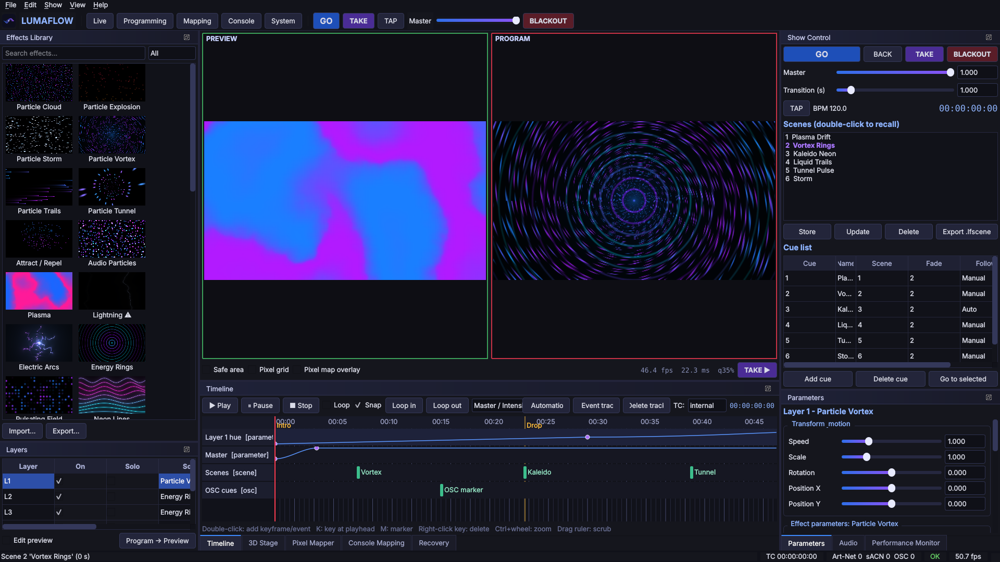

<p align="center"></p>

# LUMAFLOW 3.0

Native, offline-capable **real-time visual effects, media server, pixel mapping, spatial lighting effects and show control** software
(C++20, Qt 6, OpenGL). Works standalone or controlled from grandMA3 / ChamSys MagicQ via Art-Net, sACN, OSC and MIDI.



## Features
* 37 GPU effects, node-based effect editor (compiles to GLSL), 6-layer compositor with blend modes and masks, preview/program
* Video/image playback (FFmpeg), text and logo layers, audio-reactive effects (FFT, beat, BPM)
* Pixel mapping for strips, matrices and patched fixtures; GDTF & MVR import/export; 3D stage view; spatial effects by fixture position
* Virtual dimmer and RGB→RGBW/RGBWA conversion with calibration and brightness limiting
* Art-Net 4, sACN, OSC, MIDI, MTC/LTC; bidirectional mapping with learn, soft takeover, ownership policies, feedback
* Auto-generated console personalities (16/32/64/128 ch) with versioning, approval and rollback – `fixture-profiles/`
* Cue lists, scenes, presets, multi-track timeline; remote web UI; multi-instance sync; plugin SDK; local AI effect assistant
* Autosave, versioned backups, crash recovery, render watchdog, shader error isolation, safe mode

## Quick start
```
cmake -S . -B build -G Ninja -DCMAKE_BUILD_TYPE=Release && cmake --build build
./build/src/lumaflow --demo            # desktop app with demo show
./build/src/lumaflow-cli --help        # headless tools
```
Packages: `releases/3.0.0/` (Linux .deb / .tar.gz). Windows/macOS installers are produced by `.github/workflows/build.yml`.

## Documentation
* `documentation/LUMAFLOW_Professional_User_Manual.pdf`, `documentation/LUMAFLOW_Quick_Start_Guide.pdf`
* References: [OSC](documentation/OSC_REFERENCE.md) · [MIDI](documentation/MIDI_REFERENCE.md) · [DMX](documentation/DMX_CHANNEL_REFERENCE.md)
* [Developer guide](documentation/DEVELOPER_GUIDE.md) · [Troubleshooting](documentation/TROUBLESHOOTING.md) · [Compatibility](documentation/COMPATIBILITY_MATRIX.md)
* **[Known limitations](documentation/KNOWN_LIMITATIONS.md)** · [Hardware validation checklist](documentation/HARDWARE_VALIDATION_CHECKLIST.md)
* Progress & verification: `progress/`

## Licence
MIT (see LICENSE). Uses Qt 6 (LGPLv3), FFmpeg libraries (LGPL), zlib, SQLite, ALSA (LGPL).
